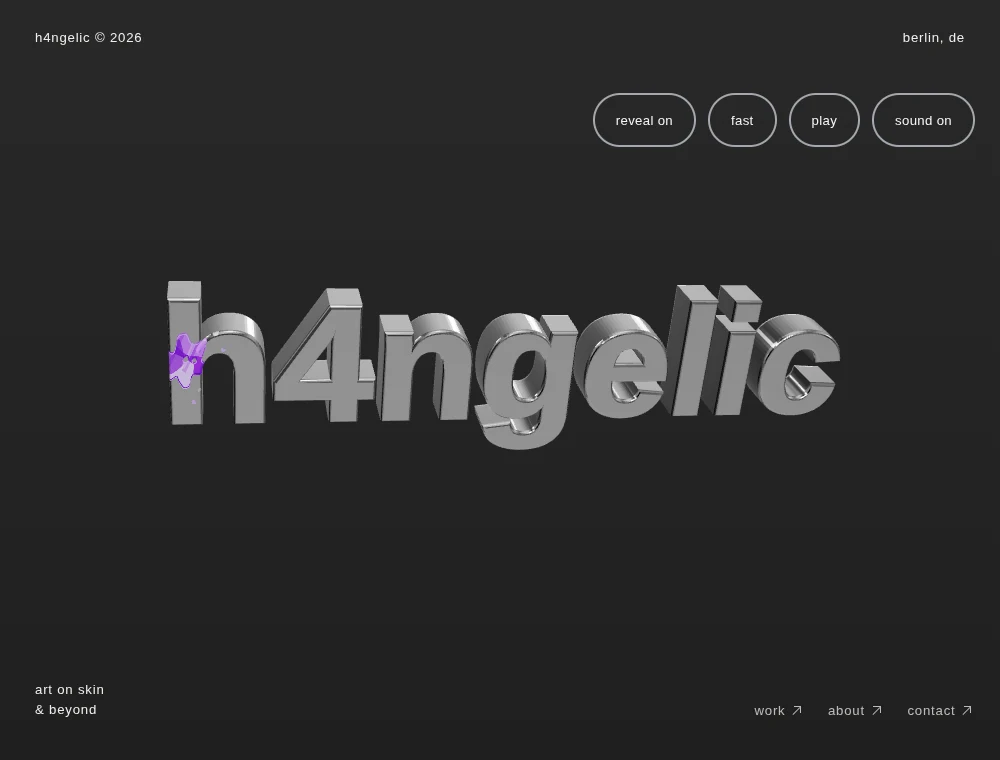
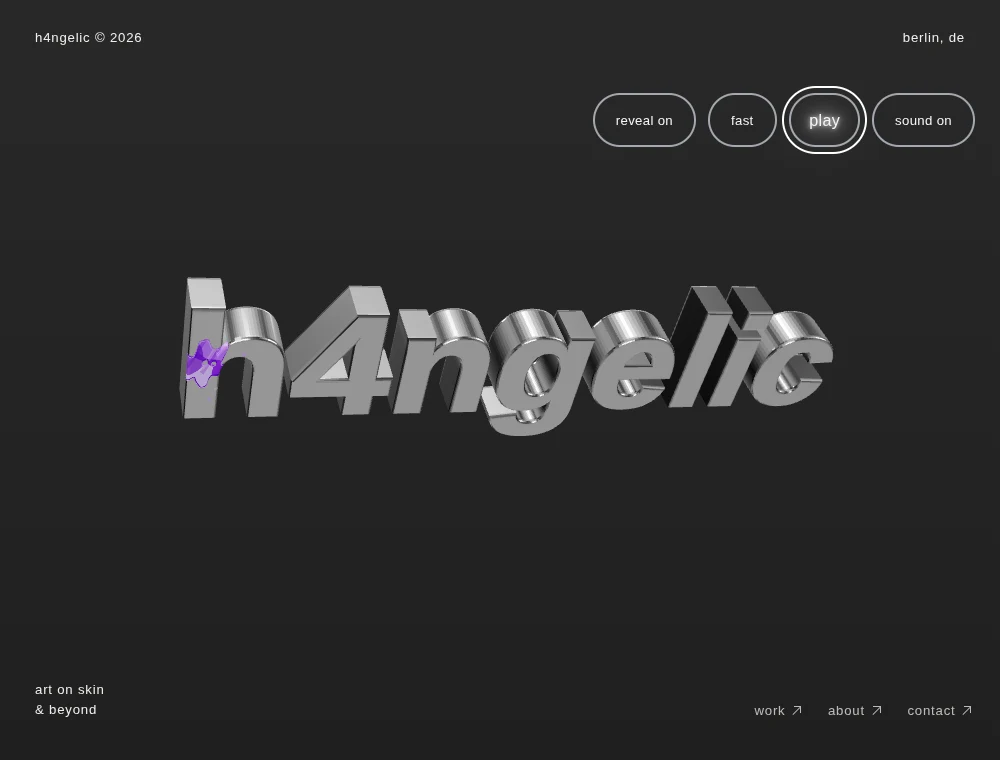
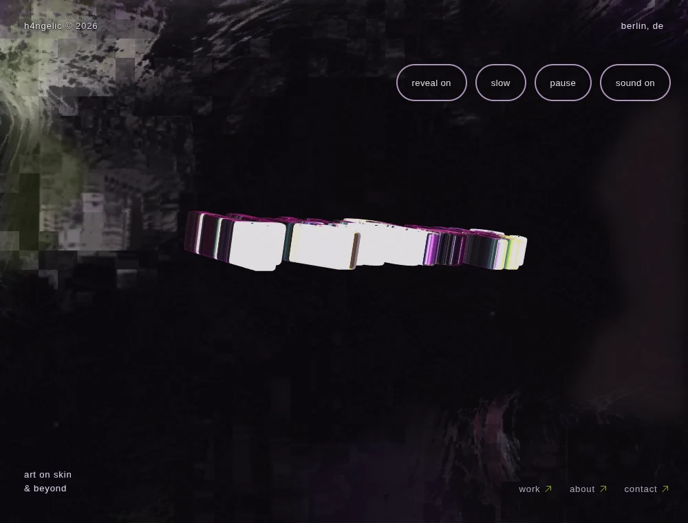
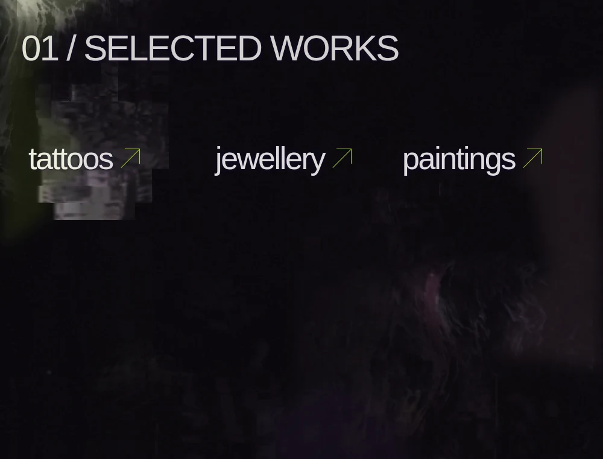

# Datamosh and surface ink — validation

Implementation: [DATAMOSH-EXPERIENCE.md](DATAMOSH-EXPERIENCE.md). Work stays on `feat/other-side-color-memory-parallax`, based on `feat/interaction-datamosh`. No production deployment or merge is part of this update.

## Core gate, before ink implementation

The required gate completed before any 3D ink source was added. `npm test` passed 230 tests and `npm run build` completed. The actual browser run at checkpoint `92cf25d` passed at 1000, 390 and 320px. Full measured evidence is retained in [color-memory-core.json](validation/color-memory-core.json).

The real browser Canvas oracle starts with a red image, changes the current source to blue, then moves the previous output twice and reverses it. The surviving red center moves to **20 → 28 → 20px** while blue data gradually enters. This uses actual Canvas2D pixels, in addition to the independent Node image-copy oracle.

Production input checks cover actual pointer strokes, subsequent motion through damaged pixels, reversal, preserved route history, eight projected hero corners, flying type, positive hover growth before leaving the link and negative contraction afterwards. The unchanged link target retains its bounds; the visual reaches 1.2× with white glow. Hidden documents, reduced motion and Normal Mode stop the continuous field. Direct Work/About visits create no WebGL scene or hero downloads.

| Viewport | Actual scroll | Actual bounded source travel | Source ratio | Browser errors |
| --- | ---: | ---: | ---: | ---: |
| 1000px | 180px | 62.28px | 34.60% | 0 |
| 390px | 180px | 63.77px | 35.43% | 0 |
| 320px | 180px | 63.77px | 35.43% | 0 |

Raw scroll accumulation is exactly .4 in these runs; the actual source eases within its finite overscan. Long-page travel continues more slowly rather than repeating tiles or hard-clamping. Buffers remain within 1120×800 desktop and 512×768 mobile; numeric cells are capped at 1400/600. The adaptive active cadence can fall below its 24/18Hz ceiling when a draw is slow. These are caps, not promises of physical-device FPS.

The native actual-page tests moved **5095 bright glyph pixels** beyond their original mask with **zero unexpected chroma**, then restored the original DOM screenshot exactly. In a native portfolio dialog, **12146 actual image pixels** moved outside their old mask. Restoration differed in 25 channels by at most one 8-bit level (mean difference .000146), consistent with browser rasterization. See [datamosh-page-pixels.json](validation/datamosh-page-pixels.json).

An unpaused native reverse capture configured to 750ms finished in **894ms**. Full mode switching is configured to 950ms and ordinary navigation to 340ms. End-to-end trusted-input wall time includes the one-second hold, cold material preparation, native snapshot setup and software rendering: the integration run observed 3.32–8.49s entering, 1.38–2.34s returning, and .85–1.24s for route commits. These lab delays are reported separately from animation settings; the environment uses Chromium/SwiftShader rather than a physical phone GPU.

Existing real CDP touch tests additionally verified the first physical movement after contact at 390 and 320px. Contact itself only records a numeric baseline; it does not paint or schedule a frame. This preserves corruption input when native panning subsequently cancels Pointer Events.

## Surface ink, implemented after the core gate

The final feature adds ten meaningful Node tests using the actual extruded wordmark and Three.js geometry. They verify separate physical components, neighbour exclusion, local projection under genuine parent rotation/translation/nonuniform scale, angled surfaces, click-versus-drag logic, unique organic textures/colors, bounded lifetimes, disposal and obsolete asynchronous decode cancellation. The complete Node suite passes **240 tests**.

The browser then uses actual mesh hits and public animation controls, with no test pose setters. At least three distinct rendered poses show **1114 / 1087 / 1239 saturated pigment pixels** near the same local surface anchor. The projected anchor travels **19.20px**, and the actual pigment-pixel centroid travels **19.56px**, with **zero local registration error**. This checks raster movement as well as coordinates. When the painted cap turns away (facing -.309), its visible pigment falls to **124 pixels**; only a small correctly wrapped bevel remnant remains.

Front and angled hits, consecutive different primary colors, six-mark eviction, empty canvas clicks, dragging, mode inhibition and route cleanup pass. After real elapsed 6–12s lifetimes, all nine tested marks have released their geometries, materials and textures. Actual renderer allocations return to their clean starting values: **1 geometry / 3 textures**.

At 390 and 320px, real touch taps produce **197 / 115 pigment pixels**, with a maximum of three marks and no duplicate flat document stamp. Native vertical touch scrolling over the mesh remains usable and creates no 3D mark. Full evidence: [surface-ink.json](validation/surface-ink.json).

The [7.2-second moving browser recording](previews/datamosh-final/rotating-surface-ink.webm) shows actual surface paint following the original rotation and perspective, disappearing behind the letter and reappearing. Startup was trimmed; the sculpture's movement was not manufactured. Existing document-attached colorful 2D ink is preserved.

| Normal surface paint | A later real pose |
| --- | --- |
|  |  |

| Shared image memory | Horizontal strip |
| --- | --- |
|  |  |

[320px actual browser view](previews/datamosh-final/other-mobile-320.webp). These are optimized copies of browser screenshots; pixel assertions were performed on their original PNG data.

## Final regression and loading measurements

`npm test` passes **240/240**, the production build passes, and **all 15 existing browser regression suites** complete serially on the feature branch. This includes navigation/import races, galleries, real photo/modal feedback, public mode gestures, actual-page captures, Web Audio/mute, interruption handling, exact cursor/favicon assets, responsive choreography, hover, offscreen/hidden WebGL suspension, physical pushing/dragging/momentum/return and no-WebGL fallback. [Complete run](validation/datamosh-regressions.json).

The 320px calibration panel passes with **28 controls**, seed reproduction, radius limits, disabled channels and keyboard lifecycle. Real mobile 4/3-tap sequences pass at 390/320px and reduced motion, including compatibility-click deduplication, cancellation, route scope, shared audio and sparse native-scroll ink. [Controls](validation/datamosh-controls.json) · [Mobile](validation/datamosh-mobile.json).

Legacy browser checks distinguish the established document-attached touch trail from accidental click marks, and the mobile h4 image from desktop native-cursor preloading. State-based physics settling retains the original numeric thresholds. Software-renderer waits were adjusted without changing mode timing or input windows.

Lighthouse 13.5 measured the freshly served production build, with no other browser/build running. Home uses the median of three mobile simulations; Work uses one. [Measured results and settings](performance/color-memory-ink-final.json).

| Metric | Home, median of 3 | Work, 1 run |
| --- | ---: | ---: |
| Performance | 67 | 100 |
| First contentful paint | 1.72s | 1.25s |
| Largest contentful paint | 2.39s | 1.40s |
| Total blocking time | 3648ms | 3ms |
| Layout shift | .00293 | 0 |
| Transferred JavaScript | 201,920B | 44,858B |
| Requests | 10 | 5 |

The homepage's existing Three.js startup is still the principal loading limitation in this software-GPU lab; the new result is not a claim of fast physical-phone loading. Work remains free of that renderer. These simulated loading scores are separate from the actual image-memory/raster integration checks and are not FPS measurements.

## Exact offline preview

[Downloadable HTML](previews/h4ngelic-preview.html) · [ZIP alternative](previews/portfolio-preview.zip). On GitHub, open the HTML file and choose **Download raw file**, then open the saved `.html` file in a browser. Public preview hosting is unavailable in this environment; the repository is private and requires its normal GitHub access.

The exact **5,482,951-byte** export passed at 1440/390/320px with all HTTP requests rejected and no runtime errors. A separate non-reduced 390px check passed native actual-page captures, keyboard `4`/`333`, mobile four-/three-taps, exact Normal restoration, zero retained capture maps and zero WebGL contexts on direct Work. The ZIP contains the identical verified HTML bytes. [Hash, methods and reports](validation/datamosh-offline.json).

SHA-256: `d14c609466968878ef9885f1ae069821bc43c7d46deb9c0292ad03ae0a8a1f4d`.

The managed browser blocks direct `file://` navigation, so validation executed the exact file bytes in an isolated document with networking rejected. This is disclosed rather than presented as a direct local-file navigation test.

## Changed source files

| Area | Files |
| --- | --- |
| New temporal kernel | `src/image-memory.js` |
| Shared field and source parallax | `src/ambient-film.js`, `src/corruption.js`, `src/corruption-lifecycle.js`, `src/corruption-field.js`, `src/temporal-mosh.js` |
| Real motion inputs | new `src/finite-hover-motion.js`; `src/motion-mosh.js`, `src/interactions.js`, `src/interactions.css`, `src/scroll-choreography.js` |
| Actual-page transitions | `src/mode-snapshot.js`, `src/mode-snapshot.css`, `src/mosh-transitions.js`, duration pass-through in `src/xray.js` |
| 3D paint | new `src/hero-ink.js`, new `src/data/heroInkSettings.js`; input/update integration and read-only diagnostics in `src/main.js` |
| Editable controls | `src/data/livingDecaySettings.js`, `ambientFilmSettings.js`, `temporalMoshSettings.js`, `interactionMoshSettings.js`, `uiEffectSettings.js` |
| Validation and delivery | new kernel/hover/ink Node and browser checks; existing field/ambient/motion/snapshot/browser checks; `package.json`, README, documentation, measured reports and offline previews |

## Reproduction

Use the development server for diagnostics and browser input checks:

```sh
npm test
npm run build
H4_BASE_URL=http://127.0.0.1:5173 H4_COLOR_VIDEO=0 npm run test:color-memory
H4_BASE_URL=http://127.0.0.1:5173 npm run test:hero-ink
H4_BASE_URL=http://127.0.0.1:5173 npm run test:regression
```

The video profile needs Playwright's FFmpeg helper; this environment reused installed `/usr/bin/ffmpeg` via a temporary helper link. No dependency was added to the project. Native snapshot structural pixel checks briefly pause the browser's snapshot animation for reliable readback; separate unpaused checks verify completion and cleanup. The rotating ink recording uses the real animation without test pose setters.

## Practical limits

This is codec-inspired image feedback, not actual encoded-video packet loss. Browser-owned DOM snapshots coordinate with material history but are not read back recursively into Canvas. Material and available photo pixels have actual previous-output feedback. Native snapshots are optional; unsupported browsers keep normal navigation and mode changes. No physical-device FPS is claimed from headless Chromium measurements.

The existing lazy Three.js hero remains the largest loading chunk. Work/About keep it separate. The Vite size advisory remains visible rather than being suppressed. Portfolio data and contact details remain intentionally unfilled until supplied.
