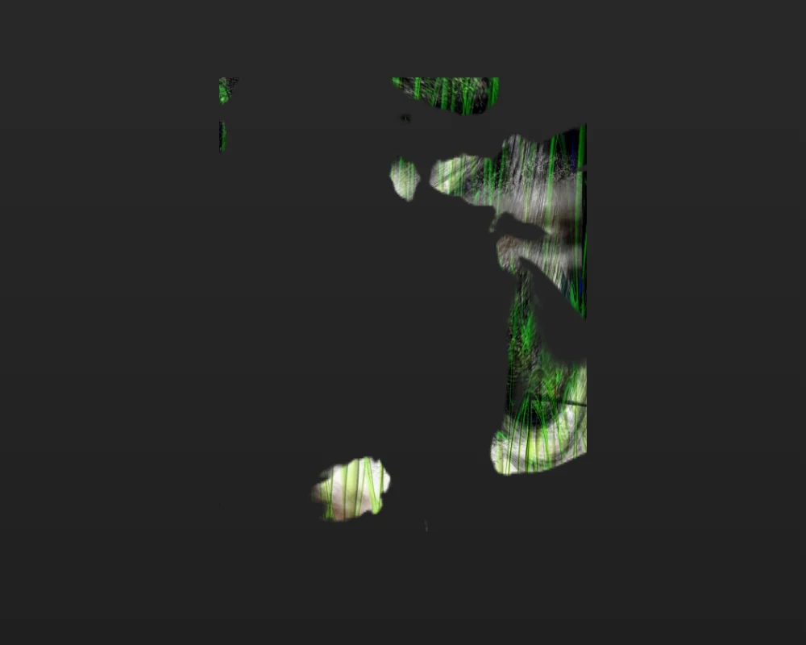
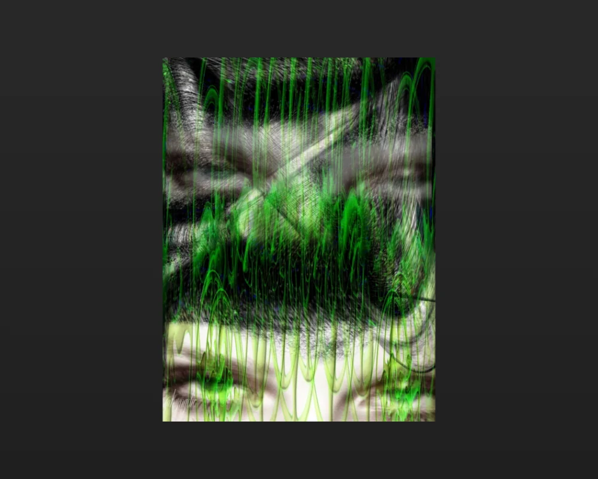
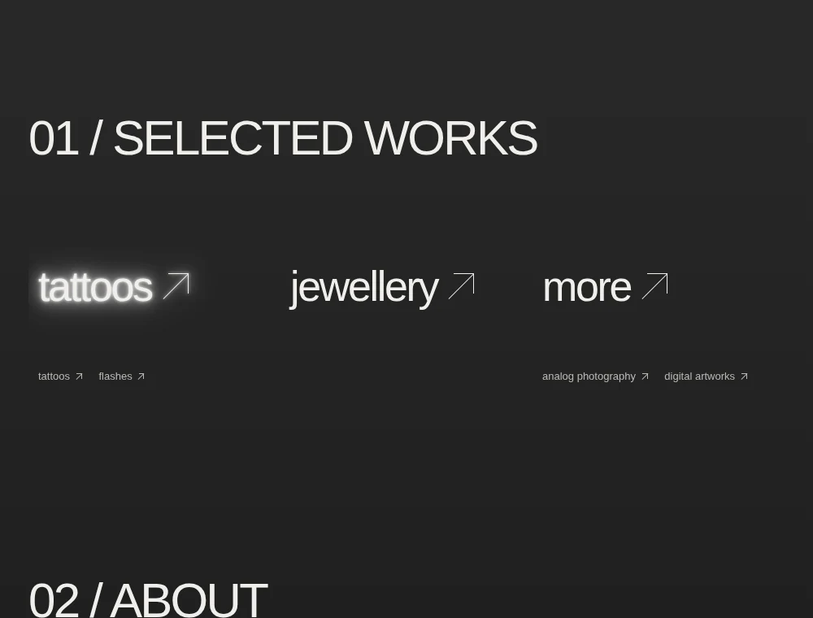
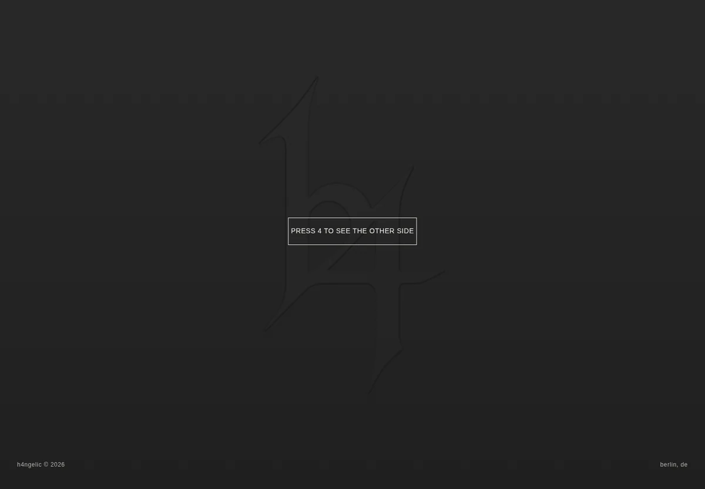
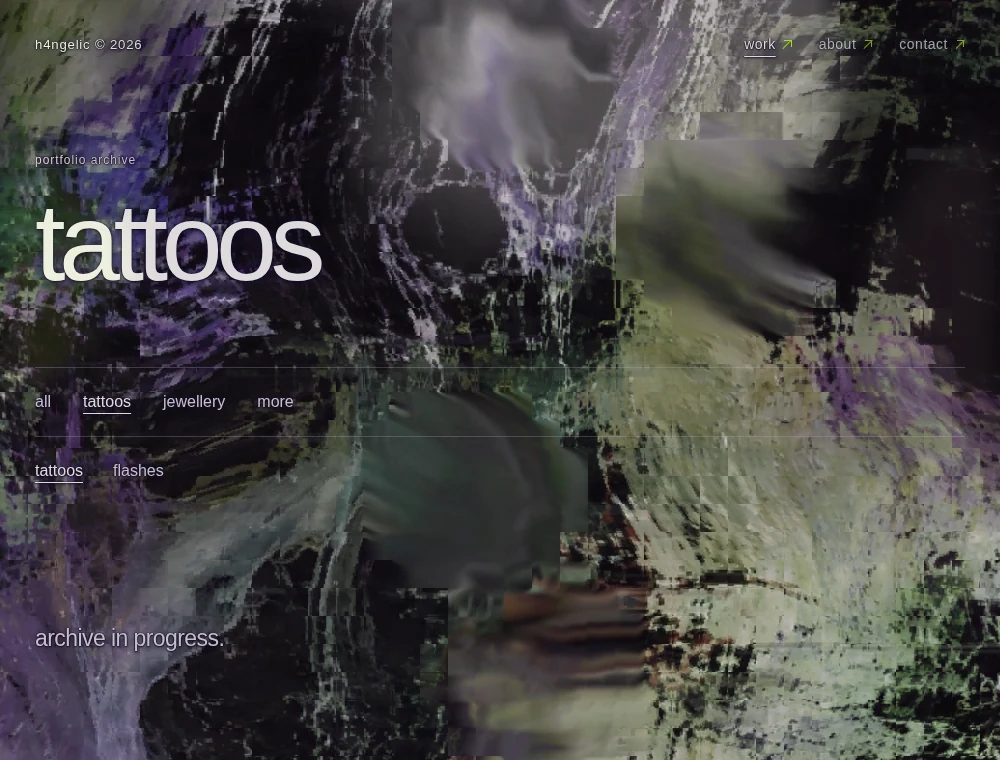
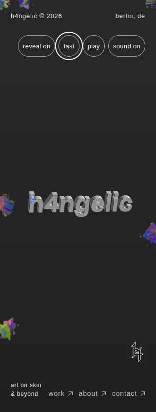

# Spatial archives and persistent material

Feature branch: `feat/spatial-archives-hidden-relief`, based on PR #14 at
`589593b`. The original hero geometry, chrome, extrusion, physics, infinity
motion, cursor assets and sound settings are retained. No merge or production
deployment is part of this update.

This is the **historical pre-V6** report for the source checkpoint `b9142dc`
and review [PR #15](https://github.com/h333ndrik/h4ngelic/pull/15). The V6
navigation/inquiry changes have a separate [working record](V6-IMPLEMENTATION.md).
Neither the checks nor the measurements below validate V6.

## Result and editable content

The homepage keeps its three horizontal editorial columns: **tattoos /
jewellery / more**, with the agreed child links. Existing paintings URLs and
projects remain supported. Tattoos, Flashes and Analog Photography share one
Horizontal Drift implementation; Jewellery retains its existing presentation.
The existing image viewer handles spatial enlargement, additional images,
Escape, focus and return to the same archive position.

The actual green-and-black JPEG supplied in the ZIP is now the first Digital
Artwork. It is preserved byte for byte, with automatically generated 320, 640,
960 and 1440px WebP files. Its 1440×1920 composition and signature remain intact.
No title, creation year or description has been invented. The local sticky
reveal follows ordinary downward scroll and reverses with upward scroll;
the finished state displays the original responsive image directly.
[Original provenance and editing](DIGITAL-ARTWORK-ASSET.md).

The exact h4 SVG becomes a scroll-controlled charcoal relief in the final
section. Depth, directional lighting and edge separation change together;
local pointer movement gently changes the light. It remains absent earlier
on the page, and the existing instruction stays above it. The established
one-second `4` and released `333` gestures remain unchanged.

The full transparent hero canvas now distinguishes a genuine mesh hit from
exposed background. Empty top/side/bottom clicks use the existing document
ink, while mesh hits retain surface paint/drag priority. Functional controls
and links remain excluded. No invisible click-blocking layer was introduced.

Living Decay's source assets, palette, brightness and bleach/white controls
are unchanged. The actual cleanup cause was residual reconstruction toward
undamaged source coordinates. Bounded signed sampling scars now preserve
structural damage as movement relaxes; the existing idle flow continues
moving previous output. Navigation and viewport changes retain the same
world. Stronger native actual-page captures retain the 950ms choreography
and use weighted displaced echoes rather than additive white flashes.
[Implementation and limits](PERSISTENT-MEMORY-MASTER.md).

| Area | Main files |
| --- | --- |
| Categories, routes, shared rendering | `siteContent.js`, `artworks.js`, `routes.js`, `pages.js`, `archive-structure.css` |
| Conditional feature loading and cleanup | `app.js` |
| Shared spatial archive | `horizontal-drift-content.js`, `horizontal-drift.js`, `horizontal-drift.css` |
| Enlargement and return | existing `gallery.js`, `artwork-transitions.js` and their styles |
| Digital artwork and reveal | `data/digitalArtworkSettings.js`, `digital-ink-content.js`, `digital-ink-field.js`, `digital-ink.js`, `digital-ink.css` |
| Hero background hit testing | `hero-background-ink.js`, `easter-eggs.js`, minimal `main.js` integration |
| Luminous rubric selection | `rubric-activation.js`, `interactions.js`/`.css`, `interaction-mosh.js` |
| Exact h4 relief | `footer.js`, `end-reveal.js`/`.css`, `data/endRevealSettings.js` |
| Persistent history and stronger captures | `image-memory.js`, `ambient-film.js`, `mode-snapshot.js`/`.css` |
| Original artwork offline | `preview-assets.js`, `image-assets.js`, `content-utils.js`, `scripts/export-preview.mjs` |
| Optional model viewer | `flash-mannequin-content.js`, `flash-mannequin.js`, `flash-mannequin.css` |

Paths in this table are under `src/` unless otherwise specified. Content
changes require data files and image assets, not changes to rendering code.
[German editing guide](CONTENT.md).

## Assets still required

The mannequin FBX/GLB/USDZ and real tattoo, flash, jewellery and analog-photo
portfolio collections have not been supplied. Their archives remain truthful
empty states. The optional Flash viewer only appears after a real project
has a validated GLB with separately named body and tattoo materials. It loads
Three.js only after the explicit 3D choice and preserves tattoo materials.
No human model, UV repair or Procreate round trip has been fabricated.
[Exact Blender/Procreate/export steps](MANNEQUIN-WORKFLOW.md).

## Verification record

Browser checks use headless Chromium with SwiftShader. They are integration
and rendered-pixel checks, not physical-device FPS measurements. Reports below
are byte-identical copies of completed runs; [source paths, timestamps and
hashes](validation/spatial-master/evidence-manifest.json) identify each artifact.
No test fixture is published as portfolio content.

| Completed check | Actual result | Evidence |
| --- | --- | --- |
| Hero coverage, 1000 / 390 / 320px | Six real background points per width, including y=1px at both top corners; mesh paint retains priority, controls work, no runtime errors. No-WebGL fallback also accepts top-background ink. | [Report](validation/spatial-master/hero-background.json) |
| Persistent material, 1000 / 390 / 320px | Real idle intervals 15.014 / 15.005 / 15.007s. Retained damaged-cell counts 1008 / 343 / 281 remain unchanged while 536,524 / 111,489 / 113,073 displayed pixels continue evolving. | [Report](validation/spatial-master/persistent-memory.json) |
| World continuity and loading | Internal navigation and actual viewport resize preserve the world; fresh entry changes seed; Normal stops the field. The tested cold interior routes create zero WebGL contexts and load no hero/Three.js. | [Report](validation/spatial-master/persistent-memory.json) |
| Actual-page typography capture | 4,598 bright glyph pixels move outside their original mask, zero unexpected colors, exact original restoration. Unsupported/reduced-motion paths and interruption cleanup pass. | [Report](validation/spatial-master/actual-page-glyphs.json) |
| Actual-page image capture | A browser-only grayscale fixture has 9,817 pixels displaced beyond its old mask and 32,707 changed pixels, with zero unexpected chroma. Restoration differs in 25 channels by at most one 8-bit level (mean .000145688). | [Report](validation/spatial-master/actual-page-image.json) |
| Digital Ink Reveal, 1000 / 390 / 320px | The actual original grows through normal scroll and reverses at the same scroll progression. Full reveal shows the responsive original `` with no image/parent filter and no canvas; reduced motion shows it statically. All profiles report zero runtime errors; 320px metadata has no overflow. | [Report](validation/spatial-master/digital-ink.json) |
| Horizontal Drift, 1000 / 390 / 320px | Native wheel forward/reverse, horizontal input, real mobile horizontal drag and vertical page pan, image/detail flights, Escape, keyboard controls and boundary release pass. Closing restores the exact recorded scroll and track position at all three widths; desktop world switching keeps the same archive node and pose. | [Test-fixture report](validation/spatial-master/horizontal-drift.json) |
| Optional model viewer, desktop / 390px touch | A test-only textured box/plane confirms explicit lazy loading, separate neutral body and retained texture, real mouse/touch rotation, reset, reduced-motion/visibility/offscreen suspension and stale-load cleanup. No human asset or UV/Procreate compatibility is represented by this fixture. | [Test-fixture report](validation/spatial-master/optional-model-fixture.json) |
| Exact h4 relief, desktop 1440×1000, touch 390 / 320px and reduced-motion 1000×800 | All four profiles hide the mark before the final area and reach relief depth 19 at the end; entry/reverse retain the silhouette and foreground instruction. Desktop pointer lighting changes 57,643 rendered pixels. Reduced motion has no material animation. Every profile reports zero runtime errors. | [Full final pre-V6 report](validation/spatial-master/pre-v6-end-relief-all-profiles.json) |

The unpaused native reverse probe configured to 750ms finished in 1396ms in
this software-GPU environment, including capture setup. This is separate from
the unchanged public 950ms mode choreography. The modal capture test
observed a maximum sampled process-tree RSS of 1,028,067,328 bytes, below
its 2GiB test guard. These values are neither
a phone-speed estimate nor an FPS result.

The final relief report above supersedes the earlier desktop-only report;
the earlier individually hashed screenshot pair remains a separate capture.
Older mobile/mask-only captures and the historical `runtime-results.json`
probe are excluded. Report timestamps, when absent, are not inferred from
filesystem modification times.

The final automated suite passes **267/267 Node tests**, and the production
build prerenders **11 routes plus 404** with preview `noindex` intact. All
**15 existing browser regression suites pass serially**: navigation,
archive/detail flights, gallery, corruption, public mode switching, native
captures, audio/mute, interrupted switching, exact icons, scroll, hover,
microinteractions, real wordmark material and physical hero interaction.
[Complete run](validation/spatial-master/interaction-regressions.json).
The report retains three resolved attempts: a stopped Vite server, snapshot
metadata sampled after an expensive PNG readback, and icon re-entry before
native navigation had finished. Restarting the server, sampling metadata
before readback and waiting for completed navigation resolved them without
changing product timing or mode behavior.

The optional mannequin's build flag is computed from published, validated
Flash placements. With the current model-free content, the production build
contains neither GLTFLoader nor a separate shared Three.js chunk. A positive
compile with that flag enabled retains the loader, so adding a real validated
placement and rebuilding activates the path without a manual feature toggle.
[Build-gate check](validation/spatial-master/mannequin-build-gate.json).
The current lazy hero bundle is 610.36kB (158.03kB gzip), rather than the
736.43kB shared Three chunk plus 34kB hero entry produced when the unused
optional loader forced shared code. These are build sizes, not FPS or a
measured end-user speed improvement; the existing large-chunk advisory remains.

The seeded Digital mask is exact in the independent Node oracle. Actual
browser readback is not byte-identical: reverse alpha mean differences were
.000741 / .029779 / .149703 levels on a 0–255 scale, with maxima 1 / 39 / 60
at 1000 / 390 / 320px. Only 0 / .0796 / .2737% of sampled pixels changed by
more than two levels; scroll progression returned to the same values. These
are recorded contour-raster differences, not a claim of exact mobile pixels.
At full reveal, comparison with a clean rendered image reference measured
mean RGB differences of 1.2831 / 1.8182 / 1.5154 levels (maxima 41 / 30 / 27).
The source image, aspect ratio and unfiltered DOM end state are verified;
these screenshot comparisons do not establish byte-for-byte raster identity.
The desktop Other Side check retains the same artwork node and publishes
eight actual mask-boundary points into the shared motion field.

| Original during scroll | Original fully revealed |
| --- | --- |
|  |  |

[390px original](previews/spatial-master/digital-original-complete-390.webp) ·
[320px original](previews/spatial-master/digital-original-complete-320.webp).
These images contain the artist's supplied work; separate synthetic mask
oracles remain test-only inputs.

The Drift test archive has 1606 / 1619 / 1429px of horizontal travel.
Recorded before/after viewer-close document scroll is identical: 531 / 396 /
445px; the existing track transforms are also identical. The 390/320px cases
use real CDP touch gestures, with both horizontal drag and native vertical
pan moving the archive. Two implementation bugs found by those inputs were
fixed: implicit capture transfer prematurely ended touch drags, and a short
mobile footer left the final part of an archive unreachable. The component
now preserves capture ownership and reserves the full horizontal travel.

The model fixture retains 7,400 / 3,072 magenta texture pixels over a neutral
body, with zero original red-body pixels. Actual drag moves the texture
centroid by 21.32 / 13.87px; reset restores its initial position. Close returns
all eight geometry buffers to zero and explicitly deletes the model texture
(6 → 5 tracked texture handles), then loses the context. The five remaining
tracked handles belong to Three.js fallback textures and are released by the
driver on context loss; this is not a claim of zero JavaScript handles.
The real model asset and authored placement remain required.

The [desktop Drift](previews/spatial-master/drift-fixture-desktop.webp),
[390px Drift](previews/spatial-master/drift-fixture-390.webp) and
[320px Drift](previews/spatial-master/drift-fixture-320.webp) screenshots use
repeated views of supplied reflection artwork **only as a test archive**.
The [desktop model](previews/spatial-master/optional-model-fixture-desktop.webp)
and [touch model](previews/spatial-master/optional-model-fixture-390.webp)
screenshots show a **synthetic box/plane test**, not a supplied human figure.
Neither fixture is added to the live portfolio.

| Horizontal homepage strip | Quiet final relief |
| --- | --- |
|  |  |

| Damaged image material after real idle | Top and side background ink at 320px |
| --- | --- |
|  |  |

Screenshots are optimized WebP copies of actual browser PNG captures; pixel
assertions used the originals. The relief capture shows the existing keyboard
focus outline on its CTA. Gallery/model fixtures, when used, are explicitly
labelled test inputs and do not establish a completed human-model/UV pipeline.

## Preview and reproduction

The downloadable **pre-V6** HTML is 7,737,644 bytes with SHA-256
`cc3530e00fcf48203ce4fa4fc43ac83a8b1479bf73525fa1c871495b070f74c0`.
The [three-width offline report](validation/spatial-master/pre-v6-offline-three-widths.json),
recorded at `2026-10-26T10:11:06.048Z`, covers 1440, 390 and 320px with zero
HTTP requests and runtime errors. Its historical `living-decay-final` contract
label does not change the recorded HTML hash. It checks the pre-V6 behavior
(including `4` entering and `333` reversing, and the old reverse hint), not the
new V6 toggle/hint specification. The [package proof](validation/spatial-master/pre-v6-offline-package.json)
records all five embedded original/derivative images and a 5,266,777-byte ZIP
containing identical HTML. The original JPEG hash is independently retained.

The exact HTML also completed the 390px non-reduced native captured-page
sequence in a [SwiftShader run](validation/spatial-master/pre-v6-offline-native-swiftshader-pass.json)
at `2026-10-26T14:54:19.427Z`, with all four mode changes captured, zero
retained maps, zero interior WebGL contexts and no HTTP requests/errors.
A [separate recorded rendering run](validation/spatial-master/pre-v6-offline-native-cpu-pass.json)
also completed. However, a [subsequent SwiftShader repeat failed](validation/spatial-master/pre-v6-offline-native-swiftshader-repeat-failure.json)
at `2026-10-26T14:59:04.745Z`: native touch handling was delayed beyond the
unchanged two-second tap window, so the sequence correctly reset. The trace
includes trusted pointer/click events and actual handler times. One passing
run does not establish repeatable performance under this software-rendering
overload; neither product timers nor event timestamps were falsified to pass.
The managed browser blocks `file://`, so offline checks execute the exact
exported bytes in an isolated document with HTTP rejected rather than claiming
a successful file-protocol navigation.

## Historical performance baseline for V6

The [recorded Lighthouse summary](validation/spatial-master/pre-v6-lighthouse-summary.json)
was generated at `2026-10-26T14:57:45.359Z` against the **pre-V6 production
build** on the local strict preview server. It contains **one mobile run per
route**, not a three-run median or desktop measurement. Lighthouse 13.5.0 and
Headless Chromium 154 used ANGLE SwiftShader, a 412×823 emulated viewport at
DPR 1.75, simulated mobile network throttling and a 4× CPU slowdown.

| Route | Performance | LCP | TBT | CLS | Transferred bytes |
| --- | ---: | ---: | ---: | ---: | ---: |
| Home | 70 | 1,446.60ms | 3,480ms | .0029254 | 391,207 |
| Work | 99 | 1,808.50ms | 39ms | 0 | 307,896 |

Full [Home](validation/spatial-master/pre-v6-lighthouse-home-mobile-1.json)
and [Work](validation/spatial-master/pre-v6-lighthouse-work-mobile-1.json)
reports are retained. Home's high blocking time is a real limitation of this
run, not evidence of a smooth physical phone. TBT is not INP; these lab runs
do not measure real-visitor p75 Core Web Vitals, desktop performance or an
improvement attributable to V6. Work requested the entry and Digital Ink
chunks and no hero/Three.js entry. All copies and their timestamps/hashes
are listed in the evidence manifest.

## Reproduction of the pre-V6 feature

```sh
npm ci
npm run dev -- --port 5173
```

Open `http://localhost:5173` on that same computer. Useful routes are
`/work/tattoos`, `/work/flashes`, `/work/jewellery`, `/work/more`,
`/work/analog-photography`, `/work/digital-artworks` and `/about`.
Contact returns to `/#contact`.

```sh
npm test
npm run build
npm run test:hero-background
npm run test:drift
npm run test:digital-ink
npm run test:persistent-memory
npm run test:mannequin
H4_BASE_URL=http://127.0.0.1:5173 npm run test:regression
npm run preview:export
```

The browser checks use installed Chromium; set `CHROMIUM_PATH` and
`H4_BASE_URL` if needed. The production preview uses
`npm run preview -- --port 4173` after building.

The [single HTML](previews/h4ngelic-preview.html) and [ZIP](previews/portfolio-preview.zip)
are downloadable artifacts. In the private GitHub repository, select
**Download raw file**, then open the saved HTML in Chrome or Firefox. A GitHub
source-file page is not a hosted interactive website. Public preview hosting
is unavailable in this environment.

The standalone export includes the actual portfolio image bytes and hash
routes. The served website keeps clean URLs and lazy runtime chunks. Offline
GLB embedding remains a future step when a genuine model is supplied.
