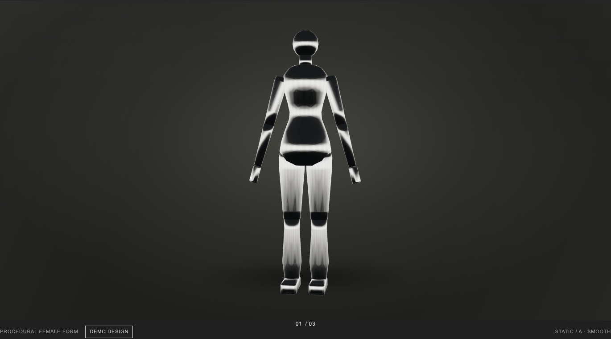
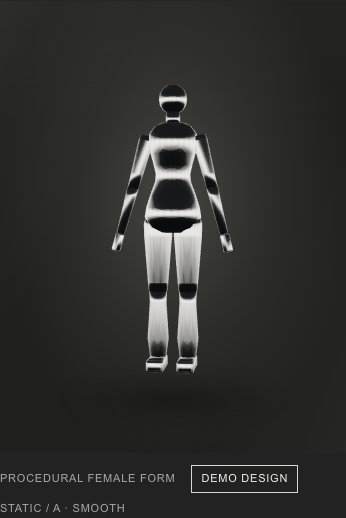
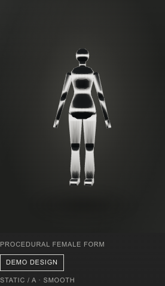
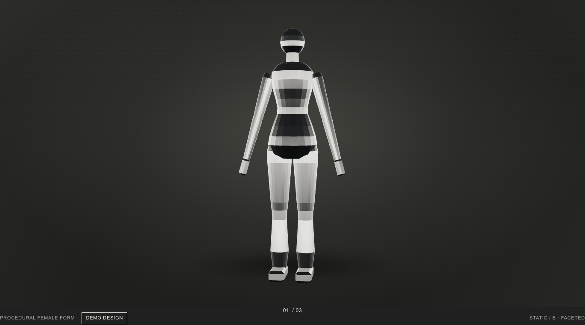
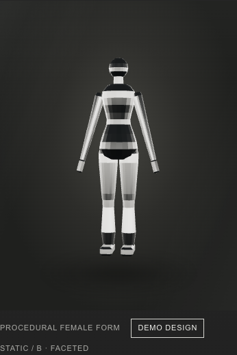
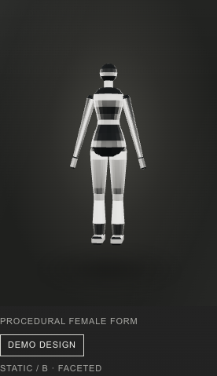
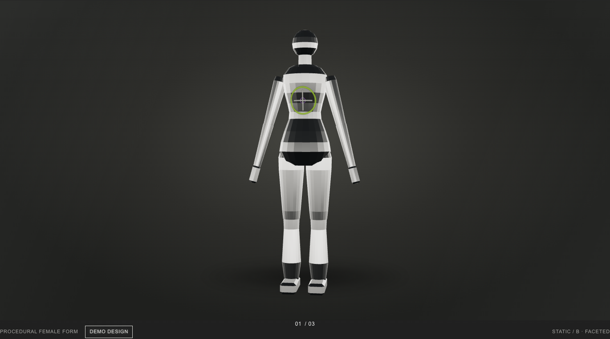
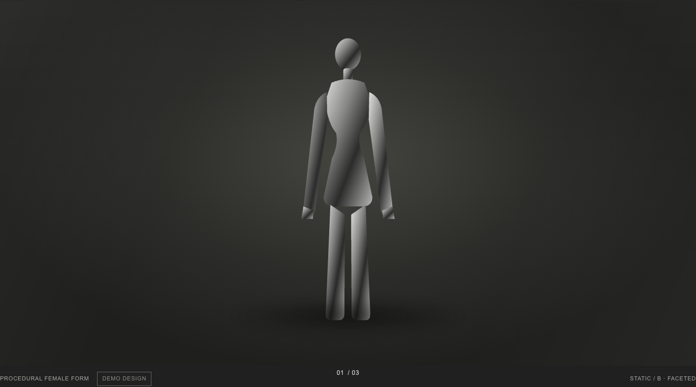
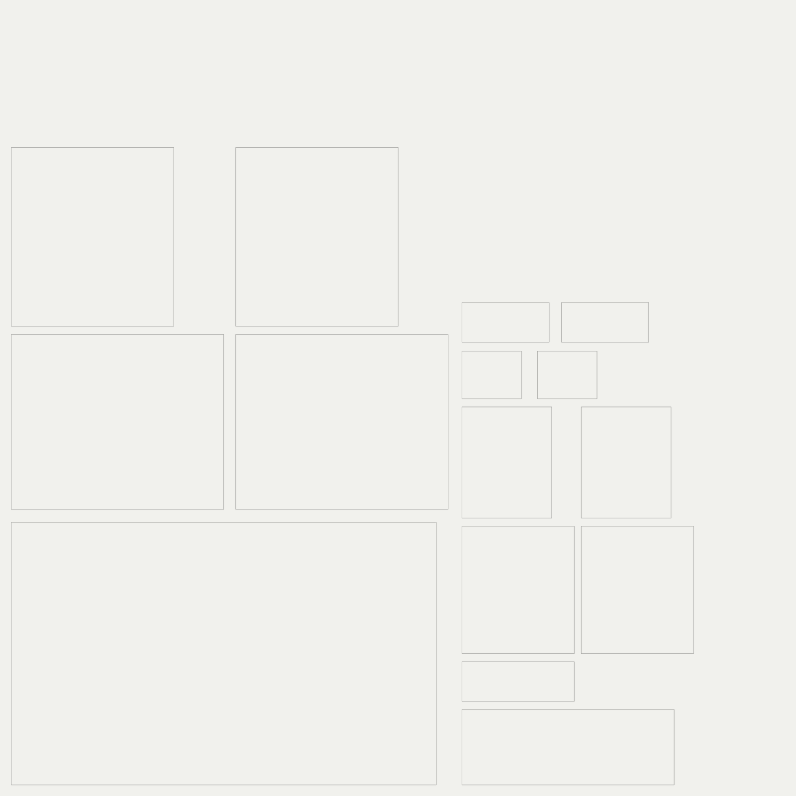

# V3.2-M0d — female chrome mannequin + Procreate roundtrip

**Status: implementation complete on `v3.2-mannequin-female`; no merge or deploy.**
**TESTMODE: full**

## Acceptance

- [x] M0c remained byte-identical before the branch work (`2b144dde…`).
- [x] Two original procedural variants; A 5,808 tris / 132,688 bytes; B 2,416 tris / 172,752 bytes.
- [x] One GLB mesh, one primitive, one `mannequin_chrome` material; no body images/textures.
- [x] Silver values and PMREM setup derived from the actual Hero material/environment.
- [x] 4096² transparent atlas at exactly 0.48828125 mm/px plus part mapping JSON.
- [x] Four 1440 orthographic views, four guide renders, 390 px render and guide.
- [x] Demo PNG imports through a lazy `DecalGeometry`; base chrome remains untouched.
- [x] Cold route: 0 WebGL, 0 GLB, 0 design, 0 preview/Three chunks.
- [x] Visible route: exactly 1 WebGL context and 1 GLB request; design waits for explicit access.
- [x] Reduced-motion and normal-motion frames remain static.
- [x] GLB failure keeps the poster and reserved 720 px frame; model-local CLS 0.
- [x] No heading overlap or horizontal overflow at 1440 / 390 / 320 px.
- [x] 379/379 unit tests, 18 routes + 404, SEO suite, 12-run browser battery.
- [x] main, mail-01-diagnostics, Hero, routing, cursor and NAAVI logic untouched.

## Addendum 1 — source gate

- **Befund:** M0c reproducibly emits the committed hash; the Hero normal silver is unique at `src/main.js:137`.
- **Umsetzung:** No Hero edit. The new branch starts from `11e78a1`; only mannequin files were added.
- **Beweis:** `MATERIAL-SOURCE.md`, `IST-SOLL.md`, and unchanged `public/models/mannequin.glb` hash `2b144dde…`.

## Addendum 2 — procedural model

- **Befund:** Female proportions need a taller one-mesh body while staying far below 6,000 tris.
- **Umsetzung:** `scripts/mannequin-female-build.py` builds fixed lathe profiles, abstract head, limbs, block hands/feet and an A-pose (15° out, 5° forward). A uses 48 segments/auto-smooth; B uses 20 segments/flat faceting. Origin is foot centre, +Y up, +Z front.
- **Beweis:** `poly-trace.json` records before/after topology, material dump and bounds. The two fresh-build `cmp` runs are byte-identical after winding-preserving index canonicalization.

| Variant | Segments | Triangles | Vertices | GLB bytes | SHA-256 |
| --- | ---: | ---: | ---: | ---: | --- |
| A smooth | 48 | 5,808 | 2,932 | 132,688 | `25c84e1558087e8a2e1954ce341680a8e9f63c305ae1b024ce7118c8bc138346` |
| B faceted (default) | 20 | 2,416 | 1,236 | 172,752 | `51e6d99a3ca50d3a42406aa4030f967c9962d8c3760443b1c5f0d412dd07591e` |

The non-deterministic part of Blender's export was triangle emission order only:
positions, normals and UVs were already equal. The builder now sorts complete
triplets lexicographically without changing their winding. Draco is available in
Blender but deliberately not enabled: both assets are already under 250 KB and
the existing GLTFLoader contract needs no extra codec/decoder request.

## Addendum 3 — chrome and environment

- **Befund:** Hero uses `#e4e4e4`, metalness 1, roughness .135, env intensity 1.35, clearcoat .15/.12, ACES exposure 1.05 and a `.035` PMREM sigma.
- **Umsetzung:** The GLB uses the same base colour, metalness, clearcoat and Hero-derived roughness (.18 A / .30 B). The client creates one three-band PMREM scene per renderer at 256 px desktop / 128 px compact, with charcoal top, bright horizon and dark floor; client env intensity is 1.35.
- **Beweis:** `MATERIAL-SOURCE.md`; screenshots show a reflective silhouette and dark/light facets rather than a flat grey fill.

Measured silhouette contrast, using median lighter body facets versus the local
dark frame background from the final screenshots:

| Width | A | B |
| ---: | ---: | ---: |
| 1440 | 1.543:1 | 1.543:1 |
| 390 | 1.893:1 | 2.481:1 |
| 320 | 1.641:1 | 1.916:1 |

All exceed the 1.5:1 gate. The method is intentionally documented: chrome has
near-black reflected facets as well as lit facets, so a single minimum-pixel
ratio would not describe the silhouette.

## Screenshots

| Variant | 1440 | 390 | 320 |
| --- | --- | --- | --- |
| A smooth |  |  |  |
| B faceted |  |  |  |

Default is **B**. A is kept through the same central configuration path for
comparison. The screenshots were captured serial against the production build,
not development source.

Demo decal applied after explicit access:



Aborted-GLB fallback:



## Addendum 4 — UV atlas and guide

- **Befund:** Procreate needs a single-scale, transparent paper-net reference; the body seam must stay on the back.
- **Umsetzung:** Body parts use straight cylindrical strips with the seam at Blender +Y / glTF -Z; the front is +Z. One UV span is 2000 mm at 4096 px. The atlas has transparent fill and 2 px black borders at 35% alpha (alpha 89).
- **Beweis:** `uv-atlas.png`, `uv-atlas-preview.png`, `uv-atlas.json`; the unit test asserts 0.48828125 mm/px, all rectangle bounds and the exact seam alpha.

`torso_front` maps the central half of the torso strip. `torso_back` records both
edge quarters in `uvRects`/`pixelRects` because the back is split by the seam.
The 1700 mm figure covers 3481.6 atlas pixels.



Guide files are in [`guides/`](guides/): 1440 front/back/left/right plus matching
12% grey/sharp-outline guides, and `front-390` plus guide. Reproducible public
copies live under `public/textures/mannequin/guides/{a,b}/`. The Procreate
contract is in [`README-PROCREATE.md`](README-PROCREATE.md).

## Addendum 5 — web lazy contract and decal

- **Befund:** M0c already had the correct single IntersectionObserver boundary; adding Three/Decal eagerly would break cold routes.
- **Umsetzung:** One config selects default B/model/design. The existing observer still imports the preview only on approach. `DecalGeometry` is a separate 3 KB dynamic chunk requested only by the **demo design** control. The base chrome material is never replaced; the demotif is a transparent overlay. Poster, status text and fixed frame reserve all layout.
- **Beweis:** `requests.json` records 0 cold requests and one GLB request per visible run. Design is 0 before access and exactly 1 after access; toggling reuses it. `DecalGeometry` is 0 before and 1 after access.

## Tests and measurements

- `npm test`: **379/379 pass** (375 baseline + 4 new).
- `npm run build`: **18 routes + 404**.
- `npm run test:seo`: 18 semantic direct routes and 18 live cold-route checks; no Three.js scene, font or reflection requests; strict 404s, canonicals, sitemap and robots pass.
- Browser: **12 production runs** = 1440/390/320 × normal/reduced × A/B.
- Model-local CLS: **0** in every run; aborted-GLB fallback CLS **0**.
- FCP observed in the local headless/Xvfb-like SwiftShader run: first cold context 1548 ms; subsequent runs 76–100 ms. These are raw local observations, not field data or a performance claim.
- Build console marker captured in each run; value stored in `requests.json`.
- Base GLB has one primitive/draw call. An explicitly activated demo adds the separate decal overlay draw, as required by the non-destructive decal contract.

Full numbers: [`requests.json`](requests.json), [`seo-results.json`](seo-results.json), [`verification.txt`](verification.txt).

## Limitations — NICHT PRÜFBAR

- Native Procreate import/compositing was **NICHT PRÜFBAR** because Procreate is unavailable in this environment. PNG/sRGB/alpha, dimensions, scale and the web re-import contract are verified.
- Real-device GPU field performance is **NICHT PRÜFBAR** in the headless SwiftShader environment.
- Browser screenshots include the existing fixed NAAVI page marker where it overlays the quiet frame footer; NAAVI was intentionally not modified.

## Rollback

```sh
git switch v3.2-mannequin
# Do not merge or deploy this branch if rollback is required.
```

The M0c files and evidence were not modified. Removing the two female GLBs,
`public/textures/`, the new config/builder/tests and the mannequin preview diff
returns the runtime to the M0c default.
