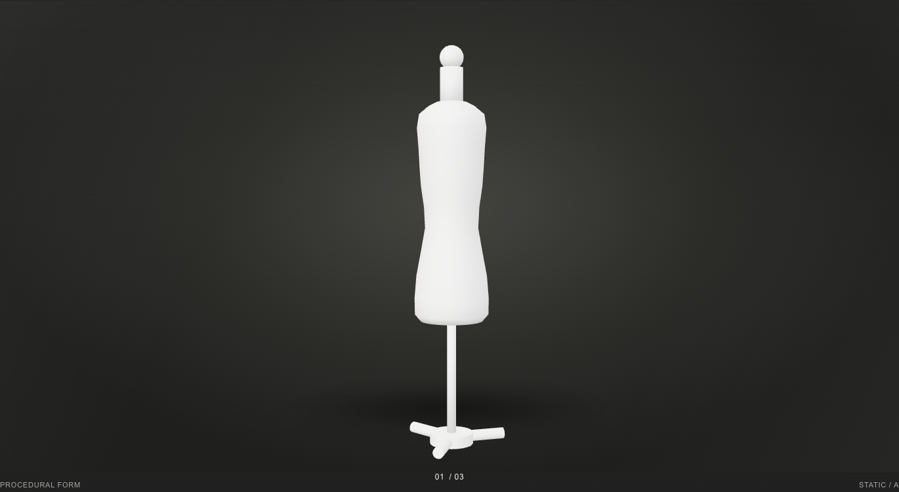
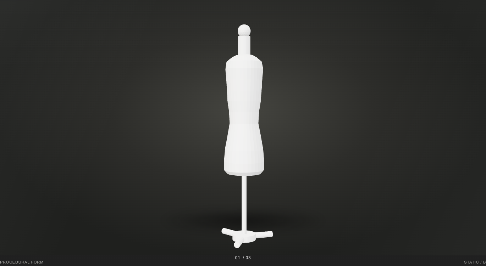

# V3.2-M0c — procedural mannequin preview

## Result

The 3D-model subsection on `/work/tattoos` now contains a white, matte,
procedural dress form. It renders one static frame when the section approaches
the viewport. There is no rotation, physics, ink or animation loop.

- Production model: `public/models/mannequin.glb`
- Builder: `scripts/mannequin-build.py`
- Default visual variant: **B — faceted brand**
- Optional comparison variant: **A — smooth studio**
- GLB size: **119,740 bytes**
- GLB SHA-256: `2b144ddec12b3490a71718a26c8c814247518fe475d7dfa59c76f0ed445952ad`
- Triangles: **1,748** (target ≤60,000)
- Vertices: **892**
- Material: `mannequin_matt`, #F0EFEB, roughness 0.85, metallic 0
- Textures/images: **0 / 0**
- Coordinate system: **+Y up, +Z front**
- Origin: foot centre at **(0, 0, 0)**; exported bounds are Y=0 through Y=1.5

## License and zero reuse

See [LICENSE-NOTE.md](LICENSE-NOTE.md). The model is an original procedural
work. The rejected external mannequin source was not used as a mesh, texture,
UV, material or structural input. No reference-asset URL, binary or
`derivedFrom` metadata is stored in this repository.

Inspection of the builder and preview files for an external mesh reference:

```text
rg -n -i 'female_mannequin|skincolor|import_scene\.fbx|\.fbx' \
  scripts/mannequin-build.py src/mannequin-preview* \
  public/models docs/validation/MANNEQUIN-PROCEDURAL
# no matches
```

The committed geometry comes only from `TORSO_PROFILE`, cylinder dimensions,
32 radial segments and the fixed seed `320032`.

## Build trace

The builder resets Blender's scene, creates all parts from authored numbers,
merges coincident vertices at `1e-6`, removes loose geometry, recalculates
normals, triangulates and verifies that every edge is manifold.

| Stage | Vertices | Triangles |
| --- | ---: | ---: |
| Authored parts before join | 892 across 9 parts | 1,748 |
| Final joined/cleaned GLB | 892 | 1,748 |

Decimation was not applied (`ratio 1.0`) because the authored lathe/primitive
model is already 97.1% below the 60k limit. Non-manifold edges: **0**. Loose
edges/vertices: **0 / 0**.

The procedural B model differs from the rejected reference asset in both
vertex count (`892` versus the inspected `48,872`) and triangle count (`1,748`
versus `97,794`). The procedural works share no geometry or topology.

Draco is available in the installed Blender build, but is intentionally not
enabled: the uncompressed GLB is only 119,740 bytes, while the browser decoder
payload would add roughly 745 KB. `tests/mannequin-procedural.test.js` asserts
that no Draco extension is required.

### Determinism

Both variants were built a second time to `/tmp` and compared byte-for-byte:

| Variant | Committed SHA-256 | Second-build SHA-256 |
| --- | --- | --- |
| A | `871ace0da9596368b6e08d095f4bcd3c780e4cba4b4c044bd42c8c5e5b9d9e4c` | identical |
| B | `2b144ddec12b3490a71718a26c8c814247518fe475d7dfa59c76f0ed445952ad` | identical |

## Reproduction

From the repository root, with Blender 4.x on `PATH`:

```bash
blender -b --factory-startup --python scripts/mannequin-build.py -- \
  --variant B --output public/models/mannequin.glb \
  --report docs/validation/MANNEQUIN-PROCEDURAL/build-report-b.json

blender -b --factory-startup --python scripts/mannequin-build.py -- \
  --variant A --output docs/validation/MANNEQUIN-PROCEDURAL/variant-a.glb \
  --report docs/validation/MANNEQUIN-PROCEDURAL/build-report-a.json
```

The executed build used **Blender 4.5.0 Alpha** and glTF Blender I/O 4.5.14.
Machine-local executable:

```bash
/Applications/Blender.app/Contents/MacOS/Blender
```

## A/B screenshots

The page uses B by default. Variant A was served only through Playwright route
interception for the comparison render; both variants are original outputs of
the same committed script.

### A — smooth studio



### B — faceted brand



Additional responsive captures:

- [A at 390](variant-a-390.png) / [B at 390](variant-b-390.png)
- [A at 320](variant-a-320.png) / [B at 320](variant-b-320.png)

Exact layout bounds, screenshot hashes, request counts and errors are in
[results.json](results.json).

## Lazy rendering and responsive checks

`tests/mannequin-preview-browser.mjs` checks the production preview at
1440/390/320:

- cold `/work/tattoos`: **0 WebGL contexts**, **0 GLB requests**, no hero or
  model-preview module request;
- after scrolling the 3D-model section into view: **1 WebGL context** and
  **exactly 1 GLB request**;
- static output marker present, no render loop;
- heading never overlaps the preview;
- canvas remains within its reserved frame and the document has no horizontal
  overflow;
- model MIME type is `model/gltf-binary`;
- A and B produce different pixel hashes at every width;
- no browser or console errors.

Preview snapshots: 1440×720, 346×452.39 and 276×390 CSS pixels.

## Test and build summary

- `npm test`: **375 / 375 passed**
- `npm run build`: **18 routes + 404**, 0 indexable in preview, clean
- `npm run test:mannequin-preview`: **6 / 6 A/B profiles passed**
- SEO HTTP/no-JS: **18 semantic direct routes**, unique metadata, canonical
  URLs, structured artist data, legacy redirects, strict 404, sitemap and
  robots passed
- SEO live interiors: direct and refreshed Work/About/Contact routes passed
  without Three.js scene, font or reflection requests; Home Contact remained
  functional

Exact command outcomes are in [verification.txt](verification.txt) and the SEO
machine report is in [seo-results.json](seo-results.json).
